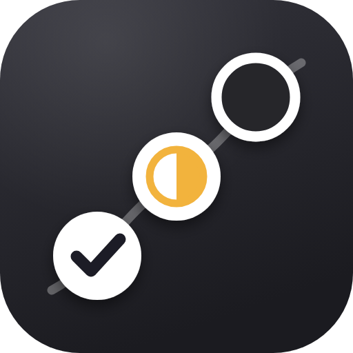
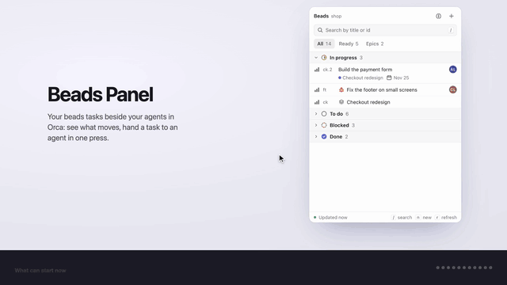
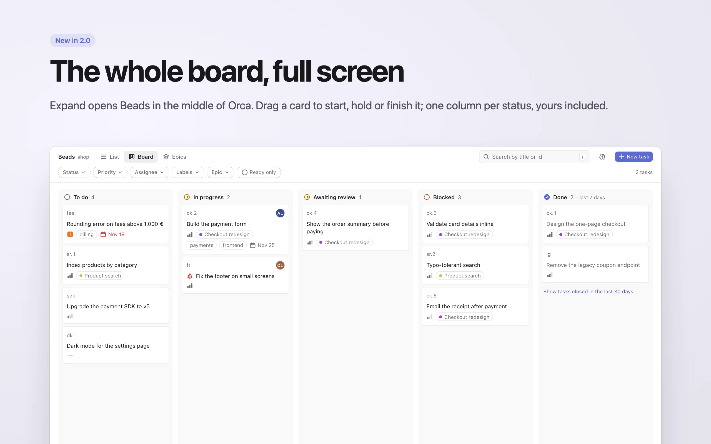
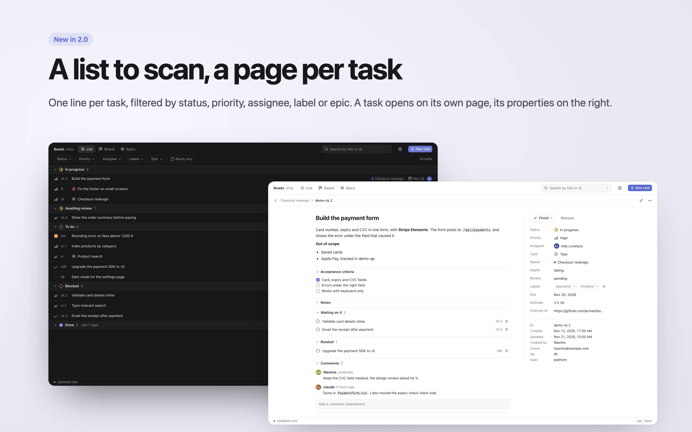
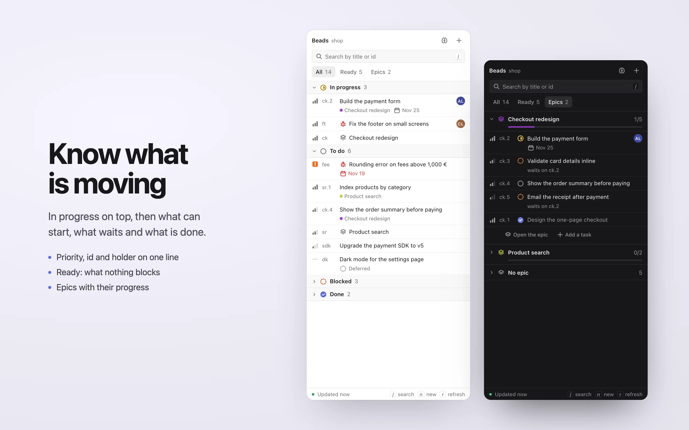
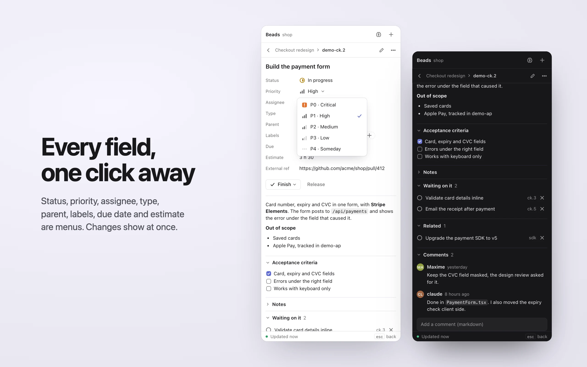
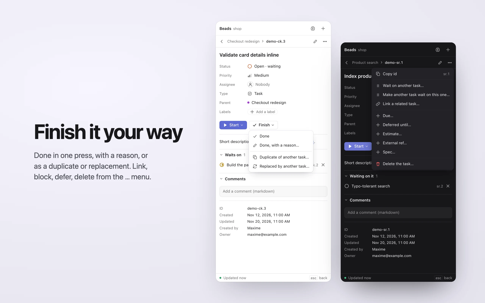
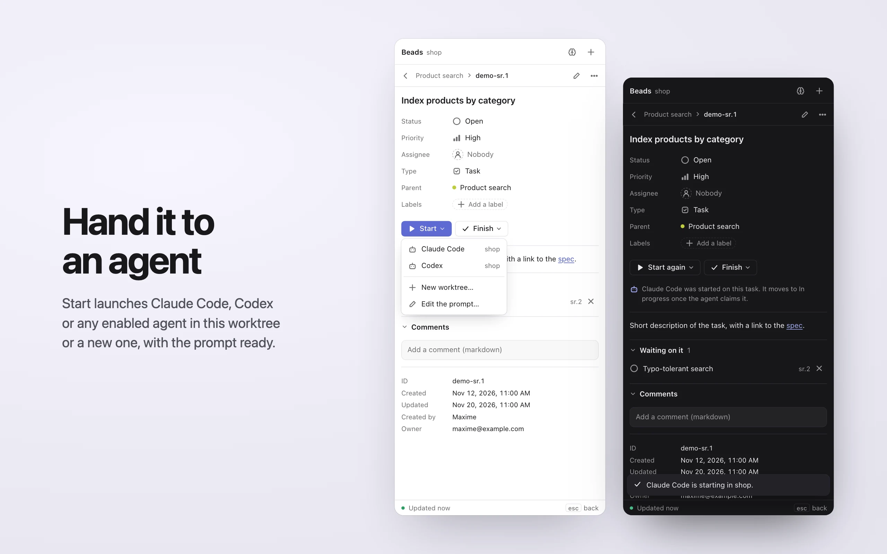
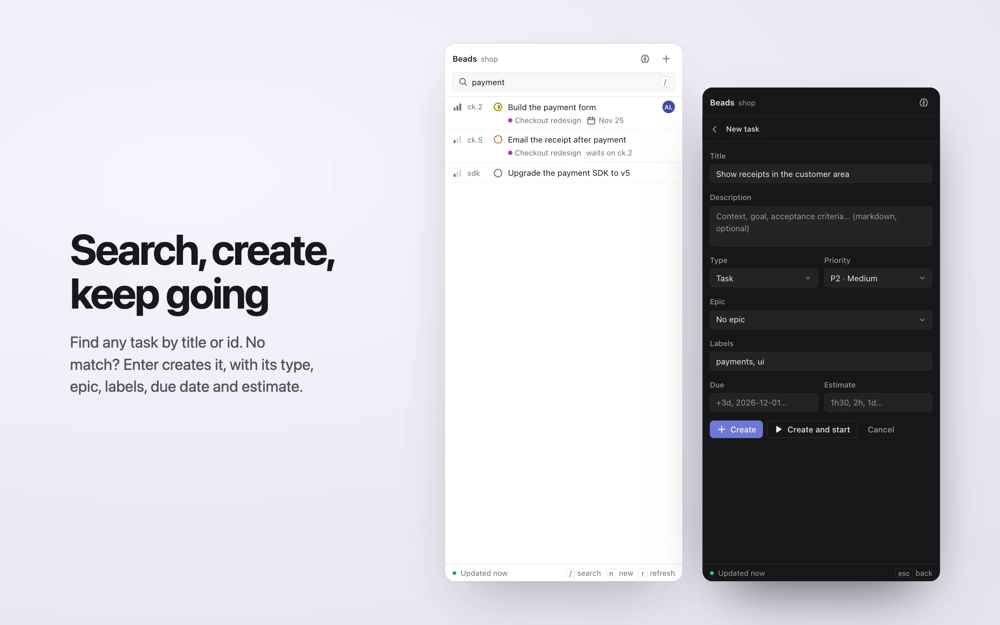
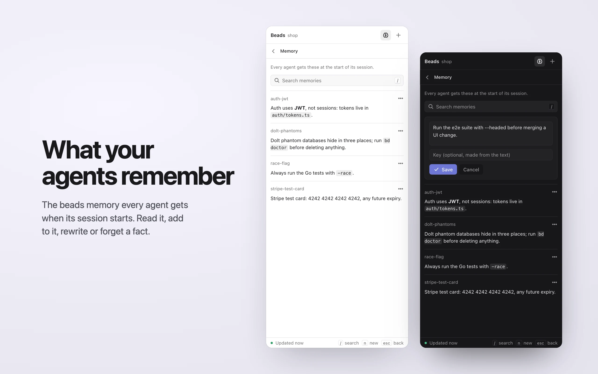

<p align="center"></p>

<h1 align="center">Beads UI</h1>

<p align="center">Your <a href="https://github.com/steveyegge/beads">beads</a> tasks beside your agents in <a href="https://www.onorca.dev">Orca</a>, and full screen in its middle: see what moves, change any task in place, and hand one to an agent in one press.</p>

<p align="center"></p>

<p align="center"><a href="https://onorca.dev/plugins/maximechbt.beads-orca-ui?catalog=community"><b>Open in Orca</b></a> · <a href="https://github.com/maximechbt/beads-orca-ui/releases/download/v1.0.0/beads-panel-demo.mp4">Watch the demo video</a></p>

<p align="center"><sub>A community plugin. Not affiliated with or endorsed by the beads project or by Orca.</sub></p>

## Why

beads keeps your project's tasks next to your code, and coding agents read and update them with `bd`. This panel puts the same tasks beside your terminals and agents in Orca, so you can see what to do next and act on it without typing `bd` commands.

## Full screen (new in 2.0)



The **expand** button opens Beads in the middle of Orca, with three views:

- **Board**: one column per state, a column per custom status included. Drag a card to another column to start, hold, reopen or finish it. Drag a column by its header, or use its **…** menu, to put the columns in your order: it is kept per project (every worktree of the repository) on your machine.
- **List**: one line per task, grouped by state, with the epic, the due date and who holds it.
- **Epics**: each epic with its progress and its tasks.

Filters on status, priority, assignee, label and epic, and a **Ready only** toggle, apply to all three. A task opens on its own page, its properties on the right; a form or the memory opens in the same window.



Orca shows a plugin in its middle only as the editor of a file, so the plugin opens an empty `.beads-board` file at the workspace root and keeps it out of git through `.git/info/exclude`, which is never committed.

## What it shows



- **One line per task**: priority bars, short id, a state glyph (ring, half-filled when moving, dashed when waiting, a check when done), the title and who holds it. A second line names the epic and what the task waits on.
- **Search** above the tabs finds a task by title or id; Enter opens the first match, or creates the task when nothing matches.
- **All**, the default tab: In progress, To do, Blocked, Done, each one folds, plus a group per custom status beside its category's. Done shows the tasks closed in the last 7 days; one press widens it to 30 or 90 days, or all, and the search finds older ones. Bugs carry a red mark.
- **Ready**: what `bd ready` lists, the open tasks with nothing blocking them.
- **Epics**: each epic with a progress bar and its tasks, subtasks included, then the tasks with no epic.

## A task in full



Press a task to see it: status, priority, assignee, type and epic on top, then its description, acceptance criteria, design and notes, subtasks, blockers, linked tasks and comments. The arrow at the top left (or Esc) goes back.

Every property is a menu: status (open, in progress, blocked, deferred, pinned, and the workspace's custom statuses), priority, assignee (you, anyone already on a task, or a name you type), type (task, bug, feature, epic, chore, decision, spike, story, milestone, and the workspace's custom types), parent and labels. States set with `bd set-state` show as properties (Health: failing), and metadata set with `bd update --set-metadata` shows with the task's dates. Due date, deferral, estimate, external reference and spec show once set; the **…** menu adds them. **Finish** closes a task in one press, or with a reason, or as a duplicate of another task or replaced by one. You can reopen a closed task, release a task an agent holds (a crashed agent's included), and edit a task's title, type, description, criteria, design and notes with the pencil. The **…** menu also copies the id, adds a blocker, makes another task wait on this one, links a related task, and deletes the task after a confirmation; the × beside a link removes it. You can also comment in markdown and add a subtask to an epic. A new task can take labels, a due date and an estimate.



## Act without leaving Orca





- **Start** a task to launch an agent on it: pick an agent and it starts in this worktree with the prompt `Start task <id>`, Orca's default agent first. **New worktree…** and **Edit the prompt…** open the full form, where you can also pick another worktree of the repository.
- **+** creates a task, an epic, or a subtask, with an optional description and epic. **Create and start** hands the new task to an agent right away.
- Once an agent is launched on a task, the task says so until the agent claims it, and Start becomes **Start again**, so a second agent is never launched by accident.
- **Sync**, in the header when the database has a Dolt remote, runs `bd sync`: it pulls the remote's commits, stops on a conflict, then pushes yours. It shows ↑ the commits to send and ↓ those to receive. The count to send needs the `dolt` CLI; without it, ↑ shows alone. The count to receive comes from a fetch, which takes a few seconds and holds the database meanwhile: the panel fetches at most every 10 minutes on its own, and when you press `r`.

Every change shows the moment you make it: the panel draws it at once and sends it to `bd`; if `bd` refuses, the panel puts things back as they were and says why.

The panel follows the focused workspace and reloads when you switch workspaces, when an agent changes state, and when you press `r`. It opens on the last tasks it showed for the workspace, with a spinner while it reloads them. It follows Orca's light or dark theme and speaks English and French, following Orca's language.

Keys: `/` searches, `m` opens the memory, `j` and `k` move through the list, Enter opens, Esc goes back, `n` creates a task, `r` reloads.

## What your agents remember



The **brain** button beside **+** opens the workspace's beads memory: the facts `bd prime` gives every agent when it starts. Read them, search them, add one, rewrite or forget one.

## Install

Install **Beads UI** from Orca's plugin catalog ([open it in Orca](https://onorca.dev/plugins/maximechbt.beads-orca-ui?catalog=community)). Orca asks you to approve the access listed below the first time.

Or install it from Git: in Orca, open **Settings → Plugins**, choose **Add plugin → From a Git URL…**, and paste:

```
https://github.com/maximechbt/beads-orca-ui#v2.1.0
```

You need:

- Orca 1.4.248 or later;
- `bd` on the PATH Orca sees (`brew install beads`), and a workspace with a beads database (`bd init`).

## Access it asks for

- **A worker** (`trusted-worker`): a Node process that runs `bd` in the workspace folder.
- **Read the focused workspace** (`workspace:read`) and **hear agent status changes** (`agent:read`), to know where to run `bd` and when to reload.
- **Open files in Orca** (`workspace:write`), for the big view: it opens the `.beads-board` file in Orca's middle.
- **Its own storage** (`storage:own`), to keep each workspace's last tasks and open view, so the panel opens on them at once.

**Start** goes through Orca's own CLI: `orca agent launch` in an existing worktree, `orca worktree create --agent` in a new one, because the plugin API cannot create a worktree and its `agent.launch` drops the prompt when an agent is slow to start. The agent opens the way a new agent tab does, as a chat or a terminal per your setting. To preselect an agent, the worker reads Orca's agent settings (`defaultTuiAgent`, `disabledTuiAgents`) and looks for agent CLIs on your login shell's PATH. It never writes to Orca's settings.

## Develop

```sh
orca plugin test .        # unit tests
orca plugin check .       # validate the manifest
orca plugin dev load .    # load this folder into Orca (asks for approval)
./scripts/demo.sh         # fill this repository with demo tasks
```

`scripts/demo.sh` rebuilds a demo beads database for this repository, the one the screenshots use. It refuses to touch a database whose prefix is not `demo`.

The panel is an HTML page, `panel/index.html` (layout and styles on Orca's theme variables), drawn with [Preact](https://preactjs.com) components written as [htm](https://github.com/developit/htm) tagged templates, so it runs with no build step. Both ship in one file, `panel/vendor/preact.js`, copied unchanged from htm 3.1.1 (`preact/standalone.module.js`): an Orca panel page cannot load scripts from a CDN, and Orca's JSX compiles for components panels only. Its script is split by job:

- `panel/app.ts` wires the keyboard, the pointer and Orca's events, then starts the panel;
- `panel/state.ts` holds the state and what survives a reload; `panel/data.ts` reads from and writes to bd through the worker (`panel/bridge.ts`); `panel/actions.ts` is what each press does;
- `panel/render.ts` is the root `App` component: the header, the footer and the current view from `panel/views/` (the list, a task and its properties, the memory, the forms), with shared pieces in `panel/ui.ts`, `panel/menu.ts`, `panel/toast.ts` and `panel/dom.ts`.

What it computes from bd's answers is in `src/model.ts`, its words in `src/i18n.ts`, and the worker is `src/worker.ts`.

## License

MIT, see [LICENSE](LICENSE).
