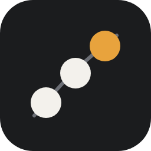
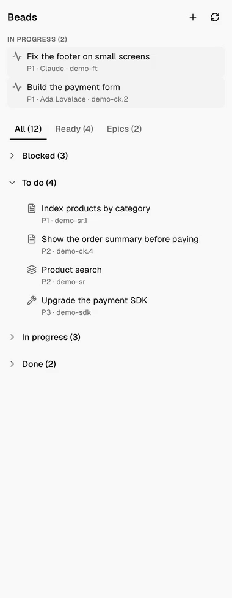
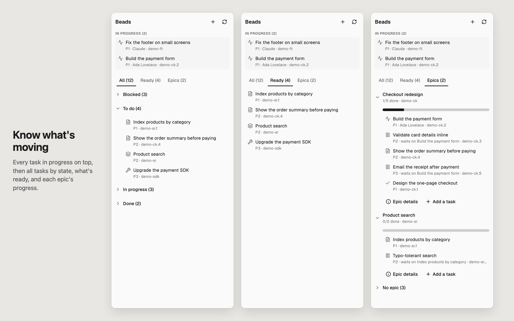
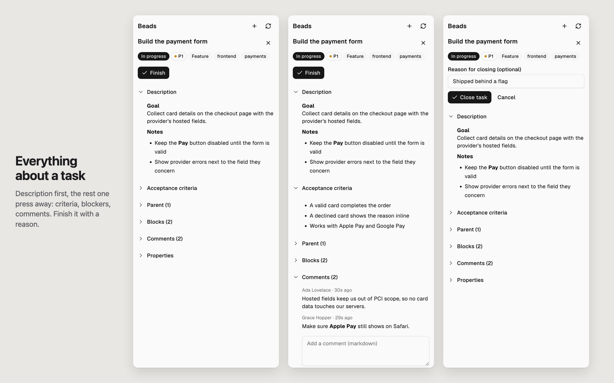
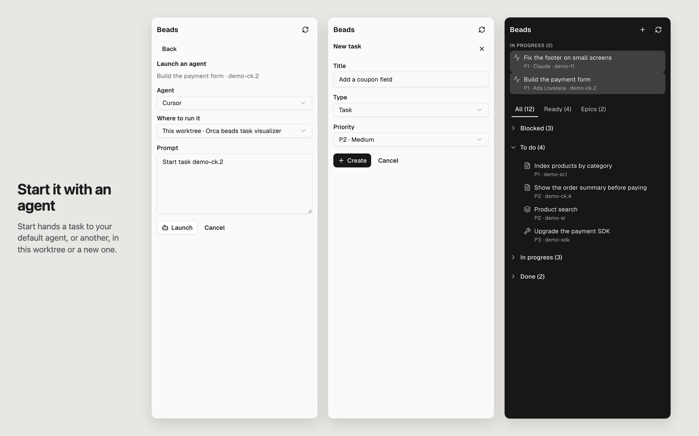

<p align="center"></p>

<h1 align="center">Beads for Orca</h1>

<p align="center">Your <a href="https://github.com/steveyegge/beads">beads</a> tasks in an <a href="https://www.onorca.dev">Orca</a> sidebar panel: see what is in progress and what is ready, then start it, finish it, or hand it to an agent.</p>

<p align="center"></p>

<p align="center"><a href="docs/demo.mp4">Watch the demo video</a></p>

## Why

beads keeps your project's tasks next to your code, and coding agents read and update them with `bd`. This panel puts the same tasks beside your terminals and agents in Orca, so you can see what to do next and act on it without typing `bd` commands.

## What it shows



- **In progress**, on top: every task someone is on, you or an agent, newest first. Epics are containers, never listed there.
- **All**, the default tab: Blocked, To do (open), In progress, Done. Each row shows its type (bug, feature, chore, epic, task); a blocked task names the task it waits on.
- **Ready**: what `bd ready` lists, the open tasks with nothing blocking them.
- **Epics**: each epic with a progress bar and its tasks, subtasks included, then the tasks with no epic.

## A task in full



Press a task to see its description. Its acceptance criteria, design, notes, parent, blockers, subtasks, comments and properties sit in folded sections, one press away. Linked tasks open on a press; the × beside the title goes back.

From there you can start a task, which hands it to an agent, finish it with an optional reason, or reopen it. You can also change its priority, assign it to yourself or to nobody, comment in markdown, and add a subtask to an epic.

## Act without leaving Orca



- **Start** a task to launch an agent on it. Orca's default agent comes preselected, and you can pick any other installed, enabled agent. Run it in this worktree, in another worktree of the repository, or in a new one. The prompt (`Start task <id>`) can be edited first.
- **+** creates a task, an epic, or a subtask.

The panel follows the focused workspace and reloads when you switch workspaces, when an agent changes state, and on refresh. It speaks English and French, following Orca's language.

## Install

Install **Beads** from Orca's plugin catalog. Orca asks you to approve the access listed below the first time.

Or install it from Git: in Orca, open **Settings → Plugins**, choose **Add plugin → From a Git URL…**, and paste:

```
https://github.com/maximechbt/beads-orca-ui#v0.2.0
```

You need:

- Orca 1.4.248 or later;
- `bd` on the PATH Orca sees (`brew install beads`), and a workspace with a beads database (`bd init`).

## Access it asks for

- **A worker** (`trusted-worker`): a Node process that runs `bd` in the workspace folder.
- **Read the focused workspace** (`workspace:read`) and **hear agent status changes** (`agent:read`), to know where to run `bd` and when to reload.
- **Start agents** (`agent:launch`), for **Start**.

A new worktree is made with Orca's own CLI (`orca worktree create`), because the plugin API cannot create one. To preselect an agent, the worker reads Orca's agent settings (`defaultTuiAgent`, `disabledTuiAgents`) and looks for agent CLIs on your login shell's PATH. It never writes to Orca's settings.

## Develop

```sh
orca plugin test .        # unit tests
orca plugin check .       # render every scenario
orca plugin dev load .    # load this folder into Orca (asks for approval)
./scripts/demo.sh         # fill this repository with demo tasks
```

`scripts/demo.sh` rebuilds a demo beads database for this repository, the one the screenshots use. It refuses to touch a database whose prefix is not `demo`.

The panel is `src/panel.tsx`, its words are in `src/i18n.ts`, and the worker is `src/worker.ts`.

## License

MIT, see [LICENSE](LICENSE).
